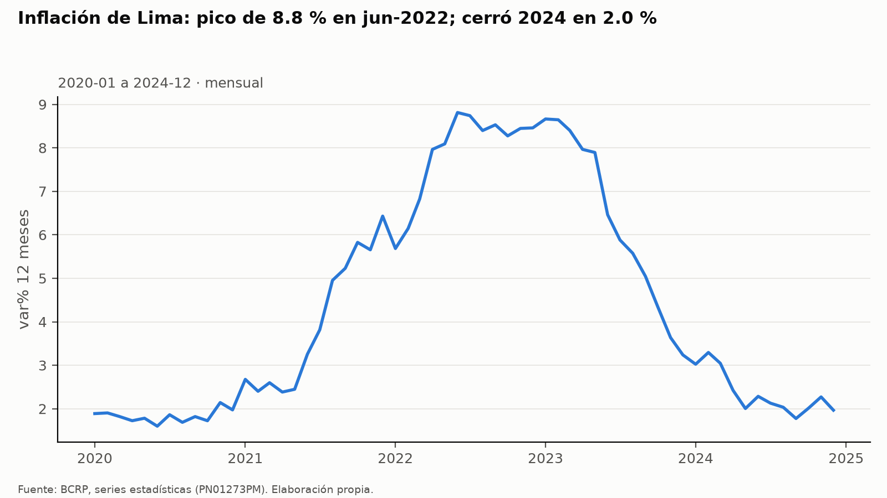
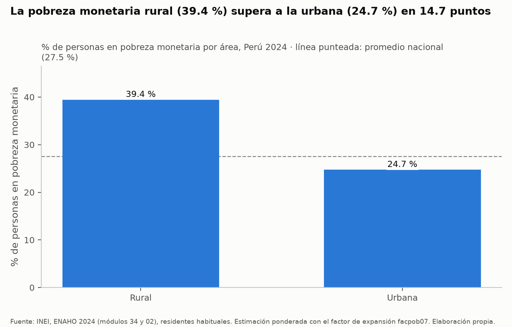
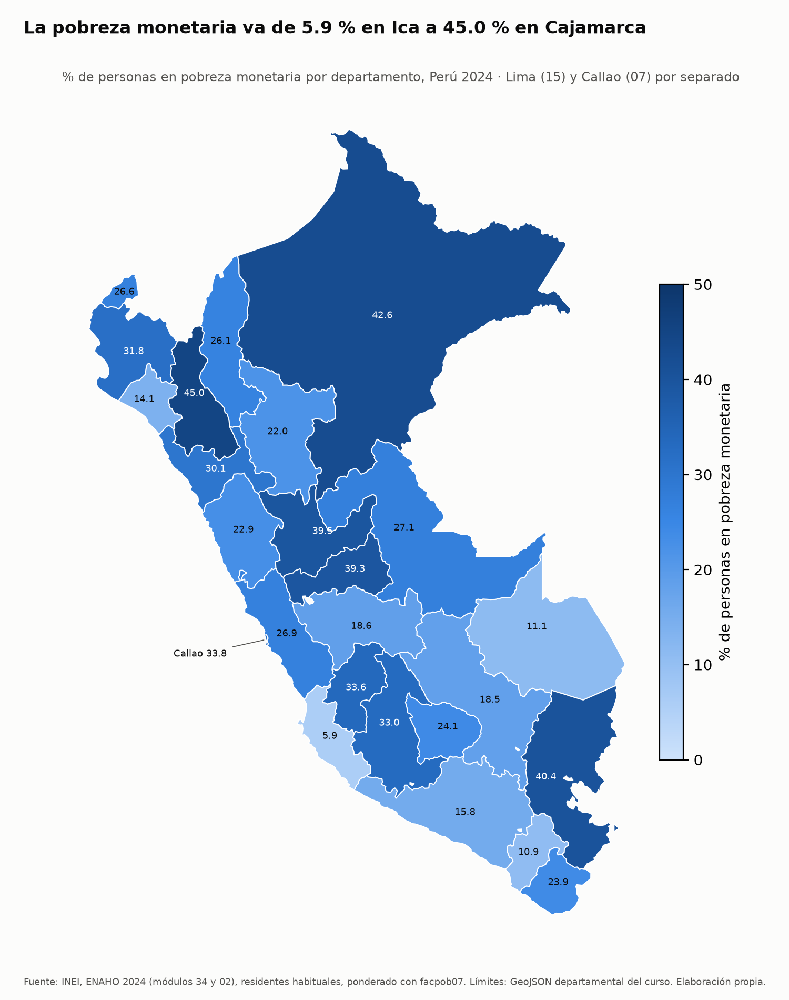

# Inflación, cobre y pobreza: Perú 2020-2024, con foco en Arequipa

Informe del agente de investigación (Tarea 4). Cifras consultadas el 8 de noviembre de 2026 con el MCP `bcrp` y las
skills `graficando-enaho` y `mapeando-enaho`. Todas las cifras salen de una herramienta o de un archivo de salida; no
hay cálculos a mano.

---

## 1. Pregunta, objetivo y delimitación

**Pregunta.** ¿Cómo evolucionaron la inflación y la producción de cobre del Perú entre 2020 y 2024, y qué diferencias
de pobreza monetaria había en 2024 entre las áreas urbana y rural y entre departamentos, en particular en Arequipa, uno
de los principales productores de cobre del país?

**Objetivo.** Describir, con datos oficiales y citados, (a) la trayectoria de la inflación a 12 meses de Lima
Metropolitana y de la producción de cobre de Arequipa entre 2020 y 2024, y (b) la pobreza monetaria de 2024 por área
(urbana y rural) y por departamento, ubicando a Arequipa en ese mapa.

**Delimitación.**

| Dimensión | Alcance |
|---|---|
| Inflación | IPC de Lima Metropolitana, var. % 12 meses, mensual, ene-2020 a dic-2024 (`PN01273PM`) |
| Cobre | Producción de cobre de Arequipa, anual, 2020-2024 (`RD15519DA`); contexto: total nacional (`RD15516DA`) y otros cuatro departamentos productores en 2024 |
| Pobreza | ENAHO 2024 (INEI), pobreza monetaria de personas, residentes habituales: nacional, urbana/rural y 25 departamentos (Lima 15 y Callao 07 por separado) |
| Tipo de análisis | Descriptivo. No se estiman efectos causales |

---

## 2. Fuentes y metodología

### 2.1 Fuentes

| Fuente | Qué aporta | Fuente original | Acceso |
|---|---|---|---|
| BCRP, series estadísticas | Inflación (`PN01273PM`) y producción de cobre (`RD15519DA`, `RD15516DA`, `RD15517DA`, `RD15518DA`, `RD15522DA`, `RD15529DA`) | INEI (IPC); Ministerio de Energía y Minas (cobre) | API del BCRP vía el MCP `bcrp` (`mcp/server.py`) |
| INEI, ENAHO 2024 | Pobreza monetaria | INEI, módulos 34 (sumaria) y 02 (miembros del hogar) | `datos/966-Modulo34.zip`, `datos/966-Modulo02.zip` |
| GeoJSON departamental del curso | Límites para el mapa | Repositorio del curso | `datos/peru_departamental_simple.geojson` |

Fichas del BCRP (recurso `bcrp://serie/{codigo}`):

- `PN01273PM`: Índice de precios Lima Metropolitana (var% 12 meses) - IPC. Unidad: var% 12 meses. Fuente original:
  INEI. Publica: BCRP, Departamento de Estadísticas de Precios. Catálogo actualizado el 2026-10-08.
  <https://estadisticas.bcrp.gob.pe/estadisticas/series/mensuales/resultados/PN01273PM/html>
- `RD15519DA`: Producción de productos mineros según departamentos - Cobre - Arequipa. Unidad: tm.f (toneladas
  métricas finas). Fuente original: Ministerio de Energía y Minas. Publica: BCRP, Departamento de Bases de Datos
  Macroeconómicas. Catálogo actualizado el 2026-04-30.
  <https://estadisticas.bcrp.gob.pe/estadisticas/series/anuales/resultados/RD15519DA/html>

### 2.2 Cómo se obtuvo cada cifra

| Paso | Herramienta | Resultado |
|---|---|---|
| Buscar la serie de inflación | `buscar_series("ipc lima 12 meses", frecuencia="Mensual")` | `PN01273PM` (IPC general; las otras 9 son subíndices) |
| Buscar la serie de cobre de Arequipa | recurso `bcrp://departamento/04` y `buscar_series("cobre arequipa")` | Mensual `RD12954DM`, trimestral `RD14265DQ` y anual `RD15519DA`. Se usa la **anual** para comparar años sin sumar meses a mano |
| Cifras de inflación | `resumen("PN01273PM", "2020-01", "2024-12")` y un `resumen` por cada año, de 2020 a 2024 | Primer y último dato, promedio, máximo y mínimo |
| Cifras de cobre | `resumen("RD15519DA", "2020", "2024")` y `serie(...)` para los cinco valores anuales | Ídem |
| Contexto del cobre | `resumen("RD15516DA", "2020", "2024")` (total nacional) y `serie(..., "2024", "2024")` para Áncash, Apurímac, Cusco y Moquegua | Valores de 2024 para comparar con Arequipa |
| Gráfico de inflación | `graficar_serie("PN01273PM", "2020-01", "2024-12", titulo=...)` | `figuras/bcrp_PN01273PM_2020-01_2024-12.png` |
| Pobreza por área | skill `graficando-enaho` → `graficar.py --por area --indicador pobreza` | `figuras/pobreza_por_area_2024.png` y cifras impresas |
| Pobreza por departamento | skill `mapeando-enaho` → `mapa.py` | `mapas/pobreza_departamento_2024.png` y `salidas/comparacion_mapa_referencia.csv` |
| Base de personas | skill `limpiando-enaho` (ya ejecutada; la base existía) | `salidas/personas_2024.parquet`, `salidas/indicadores.csv`, `salidas/validacion.txt` |

**Ponderación de la ENAHO.** La tasa principal es personas × `facpob07`: la suma de los factores de las personas
pobres dividida entre la suma de todos los factores. `limpiando-enaho` calcula además la forma en que publica el INEI,
hogares × `factor07 × mieperho` (columna `pobreza_pct_sumaria`), para nacional, área y departamento. Las dos difieren en
décimas por la unidad de ponderación; cuando se compara con cifras del INEI se usa la de la sumaria.

**Unión territorial del mapa.** Por código, nunca por nombre: `ubigeo[:2]` de la ENAHO con `FIRST_IDDP` del GeoJSON,
ambos como texto de 2 dígitos. Se unieron 25 de 25 departamentos (salida de `mapa.py`).

**Fallas de herramientas durante la consulta.** El primer `resumen("PN01273PM", "2021-01", "2021-12")` devolvió «El BCRP
no respondió con datos. Esperen unos segundos y vuelvan a intentar.». Al repetirlo respondió bien; las cifras de 2021
son de ese segundo intento. Ninguna otra llamada falló.

---

## 3. Hallazgos

### Hallazgo 1. La inflación de Lima subió de menos de 2 % a casi 9 % y volvió a 2 % en cinco años

En ene-2020 la inflación a 12 meses de Lima Metropolitana fue **1.89 %** y en dic-2024, **1.97 %**: un cambio de
apenas **+0.08 puntos porcentuales** entre ambos extremos (`PN01273PM`, 2020-01 a 2024-12, `resumen`). En el
camino tocó su mínimo del periodo, **1.60 % en jun-2020**, y su máximo, **8.81 % en jun-2022**. El promedio de los 60
meses fue **4.47 %**.

| Año | Dato de diciembre | Promedio del año | Máximo del año | Mínimo del año |
|---|---|---|---|---|
| 2020 | 1.97 % | 1.83 % | 2.14 % (nov) | 1.60 % (jun) |
| 2021 | 6.43 % | 3.97 % | 6.43 % (dic) | 2.38 % (abr) |
| 2022 | 8.46 % | 7.86 % | 8.81 % (jun) | 5.68 % (ene) |
| 2023 | 3.24 % | 6.31 % | 8.66 % (ene) | 3.24 % (dic) |
| 2024 | 1.97 % | 2.36 % | 3.29 % (feb) | 1.78 % (set) |

Fuente: `PN01273PM`, `resumen` con un rango por año (2020-01 a 2020-12, …, 2024-01 a 2024-12).

De enero a diciembre, la tasa subió **+3.75 pp en 2021** (de 2.68 % a 6.43 %) y **+2.77 pp en 2022** (de 5.68 % a
8.46 %), y bajó **−5.43 pp en 2023** (de 8.66 % a 3.24 %) y **−1.06 pp en 2024** (de 3.02 % a 1.97 %) (campo
`cambio` de cada `resumen` anual). En 2024 la serie se movió entre 1.78 % y 3.29 %.

### Hallazgo 2. La producción de cobre de Arequipa cayó 18.47 % entre 2020 y 2024, mientras la nacional subió 27.15 %

| Año | Cobre, Arequipa (tm.f) |
|---|---|
| 2020 | 556,642 |
| 2021 | 422,079 |
| 2022 | 463,462 |
| 2023 | 470,380 |
| 2024 | 453,836 |

Fuente: `RD15519DA`, 2020 a 2024, `serie`.

- Entre 2020 y 2024 la producción de Arequipa cambió en **−102,806 tm.f**, una variación de **−18.47 %**
  (`RD15519DA`, 2020-2024, `resumen`). El máximo del periodo fue 2020 y el mínimo, **2021 (422,079 tm.f)**. Desde 2021
  se recuperó en parte, pero en 2024 seguía por debajo de 2020. Promedio 2020-2024: **473,280 tm.f**.
- En el mismo periodo la producción **nacional** de cobre pasó de **2,149,116 tm.f (2020)** a **2,732,642 tm.f
  (2024)**, una variación de **+27.15 %**, con su máximo en **2023 (2,745,745 tm.f)** (`RD15516DA`, 2020-2024,
  `resumen`). Es decir, Arequipa fue en sentido contrario al total del país.
- **Arequipa sigue siendo un gran productor.** En 2024 produjo 453,836 tm.f. Entre los departamentos consultados, solo
  Moquegua lo superó (**475,930 tm.f**, `RD15529DA`, 2024); Áncash produjo **443,516 tm.f** (`RD15517DA`, 2024),
  Apurímac **321,527 tm.f** (`RD15518DA`, 2024) y Cusco **244,842 tm.f** (`RD15522DA`, 2024). No se consultaron los
  otros departamentos productores, así que esto **no** es un ranking completo.

### Hallazgo 3. En 2024 la pobreza monetaria rural (39.4 %) superó a la urbana (24.7 %) en 14.7 puntos

| Ámbito | Pobreza monetaria, personas × `facpob07` | Pobreza, método de la sumaria | Pobreza extrema | Personas en la muestra |
|---|---|---|---|---|
| Perú | 27.53 % | 27.58 % | 5.50 % | 108,664 |
| Rural | 39.44 % | 39.30 % | 15.60 % | 36,071 |
| Urbana | 24.74 % | 24.81 % | 3.13 % | 72,593 |

Fuentes: `graficar.py --por area` (imprimió Rural 39.44, Urbana 24.74, Perú 27.53 y el título «La pobreza monetaria
rural (39.4 %) supera a la urbana (24.7 %) en 14.7 puntos») y `salidas/indicadores.csv` (método de la sumaria, pobreza
extrema y tamaño de muestra).

La brecha también aparece en la pobreza extrema: 15.60 % en el área rural frente a 3.13 % en la urbana
(`salidas/indicadores.csv`).

### Hallazgo 4. La pobreza va de 5.9 % en Ica a 45.0 % en Cajamarca; Arequipa (15.8 %) es el quinto departamento con menos pobreza

- **Rango territorial:** la más alta es **Cajamarca, 44.99 %**, y la más baja, **Ica, 5.91 %** (salida de `mapa.py`;
  `salidas/indicadores.csv`).
- **Arequipa (ubigeo 04): 15.77 %** de su población en pobreza monetaria (personas × `facpob07`) y **15.78 %** con el
  método de la sumaria. Su pobreza extrema es **1.62 %**. Muestra: **4,645 personas** y población expandida de
  **1,415,224** (`salidas/indicadores.csv`, fila `departamento,Arequipa,04`).
- Ordenando la columna `pobreza_pct` de `salidas/indicadores.csv`, Arequipa es el **5.º de 25** departamentos con menor
  pobreza. Solo están por debajo Ica (5.91 %), Moquegua (10.88 %), Madre de Dios (11.14 %) y Lambayeque (14.05 %).
  También está por debajo del promedio nacional (27.53 %).
- **Lo que no se pudo medir:** la brecha urbano-rural **dentro de Arequipa**. `graficando-enaho` hace el corte por área
  solo a nivel nacional y `mapeando-enaho` solo por departamento; ninguna skill cruza departamento × área. Siguiendo la
  regla de la skill, no se improvisó un cálculo fuera de ella. Lo más cercano es usar a la vez el gráfico nacional por
  área (Hallazgo 3) y el dato departamental de Arequipa.

### 3.5 Contraste con las referencias

| Cifra | Este informe | Referencia | Resultado | Archivo |
|---|---|---|---|---|
| Pobreza nacional | 27.53 % (facpob07); 27.58 % (sumaria) | 27.6 % (INEI) | PASA a ±0.1 pp con los dos métodos | `salidas/validacion.txt` |
| Pobreza urbana | 24.74 % (facpob07); 24.81 % (sumaria) | 24.8 % (INEI) | PASA a ±0.1 pp con la sumaria | `salidas/validacion.txt` |
| Pobreza rural | 39.44 % (facpob07); 39.30 % (sumaria) | 39.3 % (INEI) | PASA a ±0.1 pp con la sumaria; la cifra con facpob07 (39.44 %) no se valida contra el INEI, porque el INEI usa la sumaria | `salidas/validacion.txt` |
| Validación de la base | 15 de 15 verificaciones, 0 esenciales fallidas | — | PASA | `salidas/validacion.txt` |
| Arequipa | 15.8 % (mapa); 15.8 % (sumaria) | 15.8 % (Sesión 16) | Diferencia de 0.0 pp con los dos métodos | `salidas/comparacion_mapa_referencia.csv` |
| 25 departamentos, método de la sumaria | — | Sesión 16 | 25 de 25 coinciden a ±0.1 pp (máx. 0.10) | `salidas/comparacion_mapa_referencia.csv` |
| 25 departamentos, método del mapa (facpob07) | — | Sesión 16 | 16 de 25 a ±0.1 pp; máx. 0.50 pp (Huánuco y Puno) | `salidas/comparacion_mapa_referencia.csv` |

La referencia de la Sesión 16 y las cifras del INEI se calcularon con la sumaria (hogares × `factor07 × mieperho`).
Con ese método coinciden todos los valores. Las diferencias de hasta 0.5 pp del mapa vienen de ponderar personas con
`facpob07` en vez de hogares: no son errores y no se corrigieron a mano.

**BCRP.** Cada cifra trae la URL de la API que la originó (sección 7). Hay tres pruebas de consistencia:

1. `graficar_serie` devolvió el mismo primer dato (1.89 %, 2020-01), último dato (1.97 %, 2024-12), máximo (8.81 %,
   2022-06) y mínimo (1.60 %, 2020-06) que `resumen` sobre el mismo rango.
2. Los `resumen` por año coinciden con el del periodo completo: el máximo de 2022 y el mínimo de 2020 son los extremos
   de 2020-2024.
3. El `resumen` de `RD15519DA` (primero 556,642 en 2020, último 453,836 en 2024, mínimo en 2021) coincide con los cinco
   valores que devolvió `serie`.

No se comparó la serie anual de cobre con la suma de la mensual (`RD12954DM`), porque eso exigiría sumar a mano.

---

## 4. Visualizaciones

**Figura 1. Inflación a 12 meses de Lima Metropolitana, ene-2020 a dic-2024** (MCP `bcrp`, `graficar_serie`,
`PN01273PM`).



**Figura 2. Pobreza monetaria por área, Perú 2024** (skill `graficando-enaho`, ENAHO 2024, ponderado con `facpob07`).



**Figura 3. Pobreza monetaria por departamento, Perú 2024** (skill `mapeando-enaho`; Arequipa es el departamento del
sur con 15.8).



---

## 5. Interpretación

1. **La inflación fue un ciclo completo y cerrado.** En 2024 la inflación de Lima volvió a un nivel casi igual al de
   inicios de 2020 (1.97 % frente a 1.89 %). Entre medio hubo dos años, 2022 y 2023, con promedios anuales de 7.86 % y
   6.31 %. Que la tasa de 12 meses haya vuelto a bajar no significa que los precios hayan vuelto a su nivel anterior:
   solo que dejaron de subir rápido. Los precios acumulados en 2021-2023 se mantienen. Las series usadas no dicen qué
   impulsó ese ciclo. Separarlo exigiría los subíndices que `buscar_series` también encontró, como el IPC sin
   alimentos y energía (`PN01277PM`) o el IPC importado (`PN09821PM`), y quedó fuera de este informe.

2. **El cobre de Arequipa y el del país no se movieron juntos.** Arequipa produjo menos en 2024 que en 2020 (−18.47 %),
   mientras el total nacional subió 27.15 %. El aumento nacional vino, por tanto, de otros departamentos. Las series no
   permiten decir de cuáles ni por qué; se necesitarían sus valores de 2020. Aun así, Arequipa siguió entre los
   mayores productores en 2024: de los departamentos consultados, solo Moquegua lo superó.

3. **La pobreza de 2024 muestra dos brechas.** La urbano-rural es de 14.7 pp a nivel nacional. La territorial va de
   5.91 % en Ica a 44.99 % en Cajamarca. Arequipa (15.77 %) está en el grupo de menor pobreza, con la quinta tasa más
   baja del país y por debajo del promedio nacional. Los otros cuatro departamentos productores consultados también
   tienen tasas por debajo del promedio nacional: Moquegua 10.88 %, Cusco 18.54 %, Áncash 22.88 % y Apurímac 24.09 %
   (`salidas/indicadores.csv`). Es una **coincidencia descriptiva** en cinco departamentos elegidos precisamente por
   producir cobre, no una relación demostrada (sección 6).

4. **Cómo se conectan las tres piezas.** La pobreza monetaria compara el gasto de cada hogar con una línea de pobreza
   valorizada a precios. Por eso la inflación es un contexto relevante para leerla. Este informe no mide ese vínculo:
   solo hay un año de pobreza (2024), así que no se puede ver si la pobreza se movió junto con la inflación o con el
   cobre entre 2020 y 2024.

---

## 6. Limitaciones

- **Niveles de agregación distintos.** La inflación es de **Lima Metropolitana**, no del país ni de Arequipa. Su ámbito
  tampoco coincide con el departamento de Lima (15) de la ENAHO, que separa a Callao (07). Para Arequipa el BCRP no
  publica un IPC actual: `buscar_series("arequipa precios")` solo encontró índices históricos de 1960-1980. El cobre es
  departamental (Arequipa) y nacional. La pobreza es nacional, por área y por departamento. No hay cifra urbano-rural
  de Arequipa (Hallazgo 4).
- **Periodos y frecuencias distintos.** La inflación es mensual (60 datos, 2020-2024), el cobre es anual (5 datos,
  2020-2024) y la pobreza es un solo corte transversal (2024). No hay serie de pobreza 2020-2024 en este proyecto:
  `limpiar.py` solo acepta 2024. Las tres medidas no se pueden poner en un mismo eje de tiempo.
- **Asociación, no causalidad.** Que Arequipa produzca mucho cobre y tenga poca pobreza no prueba que una cosa cause la
  otra. Puede haber factores comunes, como la urbanización, la estructura productiva o la conectividad, que no se
  midieron. Los cinco departamentos productores se eligieron por producir cobre, lo que sesga cualquier comparación.
  No se estimó ningún modelo ni prueba estadística.
- **Tamaño de muestra por departamento.** La ENAHO es representativa por departamento, pero con muestras pequeñas: 4,645
  personas en Arequipa y apenas 2,045 en Madre de Dios, la más chica (`salidas/indicadores.csv`). Las skills no calculan
  errores estándar, coeficientes de variación ni intervalos de confianza. Por eso diferencias de pocos puntos entre
  departamentos (por ejemplo, Cusco 18.54 % frente a Junín 18.61 %) **no deben leerse como distintas**, y el orden de
  Arequipa (5.º) puede variar dentro del margen de error.
- **Método de ponderación.** Frente a la referencia de la Sesión 16, las tasas departamentales por persona
  (`facpob07`) difieren hasta 0.50 pp y las del método de la sumaria hasta 0.10 pp (salida de `mapa.py`). En el área
  rural, la tasa por persona es 39.44 % y la de la sumaria 39.30 % (`salidas/validacion.txt`). El mapa y el gráfico
  por área usan `facpob07`.
- **Revisiones de datos.** Las series del BCRP pueden revisarse; las cifras son las vigentes al 2026-11-08. Una llamada
  a la API falló la primera vez y se repitió (sección 2.2).
- **Premisa de la pregunta.** No se verificó con un ranking completo que Arequipa sea «uno de los principales»
  productores. Solo se comparó con cuatro departamentos (Hallazgo 2).

---

## 7. Reproducibilidad

Todo se corre desde `tarea_4/` con `uv`.

**Entorno y pruebas del servidor MCP**

```bash
uv sync
uv run pytest            # 10 passed (8 pruebas del curso + 2 propias)
```

**Series del BCRP** (MCP `bcrp`, declarado en `.mcp.json`: `uv run mcp/server.py`)

| Código | Serie | Frecuencia | Periodo usado | Fuente (API) |
|---|---|---|---|---|
| `PN01273PM` | IPC Lima Metropolitana, var% 12 meses | Mensual | 2020-01 a 2024-12 (y por año) | <https://estadisticas.bcrp.gob.pe/estadisticas/series/api/PN01273PM/json/2020-1/2024-12> |
| `RD15519DA` | Cobre - Arequipa (tm.f) | Anual | 2020 a 2024 | <https://estadisticas.bcrp.gob.pe/estadisticas/series/api/RD15519DA/json/2020/2024> |
| `RD15516DA` | Cobre - Total (tm.f) | Anual | 2020 a 2024 | <https://estadisticas.bcrp.gob.pe/estadisticas/series/api/RD15516DA/json/2020/2024> |
| `RD15529DA` | Cobre - Moquegua (tm.f) | Anual | 2024 | <https://estadisticas.bcrp.gob.pe/estadisticas/series/api/RD15529DA/json/2024/2024> |
| `RD15517DA` | Cobre - Áncash (tm.f) | Anual | 2024 | <https://estadisticas.bcrp.gob.pe/estadisticas/series/api/RD15517DA/json/2024/2024> |
| `RD15518DA` | Cobre - Apurímac (tm.f) | Anual | 2024 | <https://estadisticas.bcrp.gob.pe/estadisticas/series/api/RD15518DA/json/2024/2024> |
| `RD15522DA` | Cobre - Cusco (tm.f) | Anual | 2024 | <https://estadisticas.bcrp.gob.pe/estadisticas/series/api/RD15522DA/json/2024/2024> |

Llamadas, en orden:

```text
buscar_series("ipc lima 12 meses", frecuencia="Mensual")      → PN01273PM
leer recurso bcrp://departamento/04                           → RD12954DM, RD14265DQ, RD15519DA
buscar_series("cobre arequipa")                               → RD15519DA (anual)
leer recursos bcrp://serie/PN01273PM y bcrp://serie/RD15519DA → fichas (unidad, fuente)
resumen("PN01273PM", "2020-01", "2024-12")
resumen("PN01273PM", "<año>-01", "<año>-12")                  # para 2020, 2021, 2022, 2023 y 2024
resumen("RD15519DA", "2020", "2024");  serie("RD15519DA", "2020", "2024")
buscar_series("cobre tm.f", frecuencia="Anual", limite=30)    → códigos de los otros departamentos
resumen("RD15516DA", "2020", "2024")
serie("RD15529DA" | "RD15517DA" | "RD15518DA" | "RD15522DA", "2024", "2024")
buscar_series("arequipa precios")                             → sin IPC actual de Arequipa
graficar_serie("PN01273PM", "2020-01", "2024-12",
               titulo="Inflación de Lima: pico de 8.8 % en jun-2022; cerró 2024 en 2.0 %")
```

El catálogo de series se baja la primera vez a `mcp/datos/catalogo_bcrp.csv` desde
<https://estadisticas.bcrp.gob.pe/estadisticas/series/metadata>.

**ENAHO 2024** (skills en `.claude/skills/`)

```bash
# 1. Solo si falta salidas/personas_2024.parquet (skill limpiando-enaho). Microdatos del INEI:
#    https://proyectos.inei.gob.pe/iinei/srienaho/descarga/STATA/966-Modulo34.zip
#    https://proyectos.inei.gob.pe/iinei/srienaho/descarga/STATA/966-Modulo02.zip
uv run .claude/skills/limpiando-enaho/scripts/limpiar.py --anio 2024
#    → salidas/personas_2024.parquet, salidas/indicadores.csv, salidas/validacion.txt

# 2. Pobreza por área (skill graficando-enaho)
uv run .claude/skills/graficando-enaho/scripts/graficar.py --por area --indicador pobreza
#    → figuras/pobreza_por_area_2024.png

# 3. Mapa por departamento (skill mapeando-enaho; baja el GeoJSON si falta)
uv run .claude/skills/mapeando-enaho/scripts/mapa.py
#    → mapas/pobreza_departamento_2024.png, salidas/comparacion_mapa_referencia.csv
```

`datos/` y `salidas/*.parquet` están en `.gitignore`: se regeneran con los comandos de arriba.

**Archivos que respaldan las cifras**

| Archivo | Contenido |
|---|---|
| `salidas/validacion.txt` | 15 verificaciones de la base y contraste con las cifras del INEI |
| `salidas/indicadores.csv` | Pobreza y pobreza extrema por nacional, área, sexo, edad y departamento; población expandida y tamaño de muestra |
| `salidas/comparacion_mapa_referencia.csv` | Pobreza por departamento con los dos métodos frente a la referencia de la Sesión 16 |
| `figuras/bcrp_PN01273PM_2020-01_2024-12.png` | Figura 1 |
| `figuras/pobreza_por_area_2024.png` | Figura 2 |
| `mapas/pobreza_departamento_2024.png` | Figura 3 |
